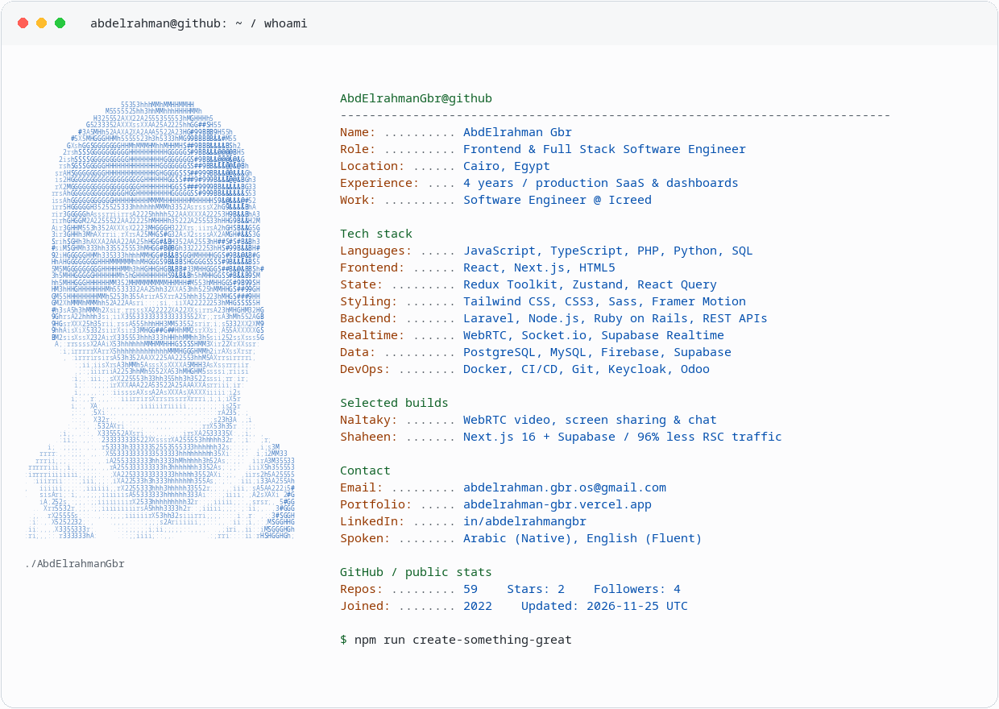

<picture>
  <source media="(prefers-reduced-motion: reduce) and (prefers-color-scheme: dark)" srcset="./assets/profile-dark.svg">
  <source media="(prefers-reduced-motion: reduce)" srcset="./assets/profile-light.svg">
  <source media="(prefers-color-scheme: dark)" srcset="./assets/profile-dark.gif">
  
</picture>

<p align="center">
  <a href="https://abdelrahman-gbr.vercel.app/">Portfolio</a> &nbsp;·&nbsp;
  <a href="mailto:abdelrahman.gbr.os@gmail.com">Email</a> &nbsp;·&nbsp;
  <a href="https://www.linkedin.com/in/abdelrahmangbr">LinkedIn</a> &nbsp;·&nbsp;
  <a href="https://discord.com/users/279880612955947009">Discord</a> &nbsp;·&nbsp;
  <a href="https://www.facebook.com/AbdElrahman.Gbr97">Facebook</a> &nbsp;·&nbsp;
  <a href="https://x.com/AbdelrahmanGbr4">X</a>
</p>

<details>
<summary>Tech stack, experience & projects</summary>

```text
AbdElrahman Gbr
Frontend and Full Stack Software Engineer / Cairo, Egypt
4 years building production SaaS applications and dashboards

Frontend    : React, Next.js, TypeScript, JavaScript ES6+, HTML5
State       : Redux Toolkit, Zustand, React Query
UI          : Tailwind CSS, CSS3, Sass, Framer Motion
Visuals     : React Visualize, Chart.js
Backend     : Laravel, Node.js, Ruby on Rails, PHP, REST APIs
Realtime    : WebRTC, Socket.io, Supabase Realtime
Data        : PostgreSQL, MySQL, Firebase, Supabase, SQL
Tools       : Docker, CI/CD, Git, Odoo, Keycloak, Python
CMS         : Filament, Drupal
Languages   : Arabic (Native), English (Fluent)
```

| Experience | Role | Dates |
| :--- | :--- | :--- |
| Icreed | Software Engineer | Jul 2025 – Present |
| Freelance & Open Source | Full Stack Developer | Jan 2024 – Present |
| Digital Vibes | Mid-Level Frontend Developer | Oct 2023 – May 2026 |
| Naseej | Software Engineer, Contract | Jul 2023 – Oct 2023 |
| 4explain | Junior Frontend Developer | Dec 2022 – Oct 2023 |

- [Naltaky](https://abdelrahman-gbr.vercel.app/projects/j97dns63wt02d4ywa2t1mbgdd582q68a) — React and WebRTC conferencing with video, screen sharing, chat, and meeting analytics.
- [Shaheen Translation Platform](https://abdelrahman-gbr.vercel.app/projects/j976g63r1htgjdaychzhavjtsh8e9daj) — Bilingual Next.js 16 and Supabase platform, 37 routes and 23 PostgreSQL tables. Reduced auth-driven RSC traffic by 96%, with 25/25 passing contract tests.
- [DVConnect CRM](https://abdelrahman-gbr.vercel.app/projects/j971rngsb9dr8cxe2a0hjeexbn82p7tr) — Lead tracking, Chart.js dashboards, Firebase and Meta chat, and optimized Redux state.
- [Makook Admin System](https://abdelrahman-gbr.vercel.app/projects/j97bb1dwv5kerfbjv6bbtn9evh82qdht) — React dashboards with vendor locations, live driver telemetry, and revenue visualization.
- [Darah Foundation Portal](https://abdelrahman-gbr.vercel.app/projects/j977d6wmbh8gsznj7n2bhs050n82q44z) — Multilingual Next.js heritage portal for the King Abdulaziz Foundation.

**Education:** ITI Professional Diploma in Open-Source Application Development (2021–2022); Bachelor's in Biological Agriculture (Biotechnology), Kafr El Sheikh University (2015–2019).

**Off the clock:** League of Legends, Fortnite, and auto chess.

</details>
